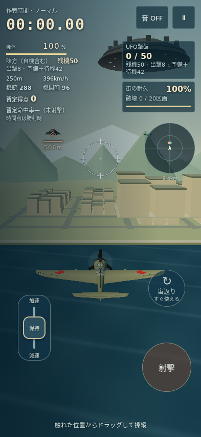
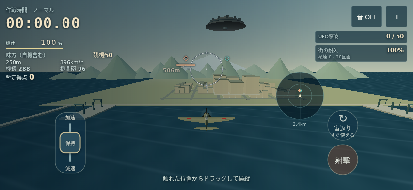
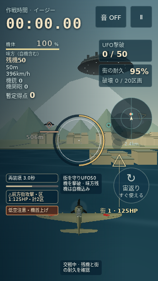
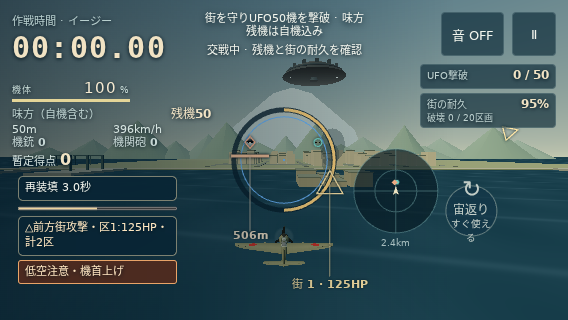

# カイセン表示に合わせる追補とEasy通知の修正

比較元はカイセン main `b5c44346139901c195084000d172f89374a623b9`。初回比較の基点は main `28960ba326679f7ca32531483495c60dc7fceaf9`。その後、PR #16が main `5ef75c6061b0740687ecaac26e0b932604deb3d2`に採用されたため、本追補はその表示と音を保持して不足を補う。利用者の2026年10月13日の指示に対応する。

PR #16の基本表示・音声を保持し、自機HPの幅と数値、レーダー専用色、表示範囲、照準とレーダーの重なり順を合わせる。Easyで複数通知が照準や自機を隠す問題と、小さい横画面でレーダーが消える問題を直す。

## 最終画面で合わせた内容

| 表示 | カイセンの基準と本変更 |
| --- | --- |
| 敵・味方の印 | 敵は桃色 `#ffb28b` の幅10px・高さ12pxのひし形。味方は緑色 `#77dacb` の半径4pxの円 |
| 敵のHPと距離 | HPバーは38×3px、残HPの割合を表示。距離は淡色 `#f4e3c8`、機体から1,500m以内を表示 |
| 照準 | Normal/Easyの半径、白・赤・青の状態色、中央点、Normalの暗い縁、再装填の進行円を共通化。既存の標的選択・遮蔽判定を読んで表示する |
| 自機のHP | 118px幅を上限にした3px高のバー、右寄せの割合、9pxラベル・15px数値を共通化 |
| レーダー | 2.4km、敵のひし形・味方の円・自機の矢印、範囲外の空洞マーク、専用色 `#ffb78c` / `#70d8c7`を共通化 |
| 情報の配置 | 機体情報と味方残機を左上、敵と街の情報を右上へ。レーダーと文字は照準・情報・操作ボタンを避ける |

レーダーはカイセンの49px/42px半径を使う。49pxで配置できない場合は42pxで再探索する。街の耐久、有限50機の出撃・予備・待機、UFO撃墜時の花火は本作の機能として保持する。低空警告の見た目はカイセンに合わせ、発生条件70mは本作の既存条件を保持する。

短い画面では命中率や予備の内訳を常時表示から省き、一時停止の「戦況詳細」で確認できるようにした。低空・装填・街攻撃・開始・交戦通知が同時に出る場合も検査対象にし、Easyの中央の照準とNormalの照準に合わせて別々に配置した。戦況詳細はキーボードでも開ける。

## PR #16で採用されたプロペラ音

本追補は採用された音声コードを変更しない。PR #16で、音はカイセンと同じ3つの波形を重ねる構成になった。周波数は `(40 + speed × .13) × 1, 2, 3`、各音の強さは `.45 / .20 / .12`、プロペラ部の設定値は `.0475`。効果音全体の設定値 `.23`は保持し、プロペラ音を控えめにする。カイセン全体の設定値は `.6`なので、最終出力の音量が完全に同じという意味ではない。

実際の両作品の音声コードをブラウザのOfflineAudioContextへ接続して、65/110/140m毎秒で測定した。変更前のマチマモレに比べ、音の信号の実効値は49.4〜49.6%減った。カイセンとの比は約38.3%。これは信号の測定であり、聞こえる大きさが半分になるという判定ではない。音源3つも既存の10音源上限に含め、停止・再出撃・破棄時に解放する。

## 検査と確認

最終候補の自動検査、画像、独立レビューは [verification.json](evidence/kaisen-ui-audio-20261013/verification.json) に記録する。描画・遮蔽表示・音の測定では、ゲームの時刻・乱数・損傷・スコアを変更していない。

ローカルの画像は固定表示用の状態を実製品の3D描画で撮影したもので、通常操作によるゲーム全勝やiPhone実機の検査ではない。LinuxのChromium、Noto Sans JP、ソフトウェア描画を使用した。標準Chromium/WebKitの4画面は最新PR headのGitHub Actionsで別に確認する。実機Safari、タッチの感触、端末スピーカーでの聴感は未確認。

別担当6.1Sol Extra Highが最終100ファイルのdigestと9画像を独立確認し、未解決のP1/P2指摘なしと判定した。Easyの多重通知とレーダー消失、通知用サンプルの表示順、街ラベル、自機を隠す通知、空の通知背景を修正した。PRを提出し、マージと公開は利用者の採用後に行う。

## 確認用の画像

9条件を原寸で開いて確認し、次の4枚をPRに保存する。残り5枚のhashと全9条件の観測値もverification.jsonに記録する。

